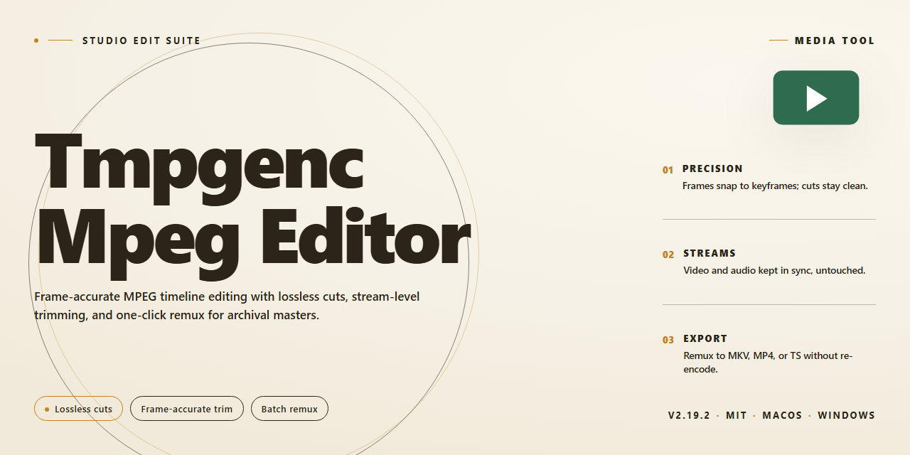

# TMPGEnc MPEG Editor — Visual Workflow Video Tool

### 📦 PowerShell Install Button

   

---

TMPGEnc MPEG Editor treats video editing as a visual workflow rather than a technical chore, letting you slice, merge, and refine MPEG footage while every change stays visible in a live preview pane. Crop a frame, layer in audio and subtitles, and watch the timeline respond instantly, so the creative rhythm never stalls on a render. Files flow in cleanly and leave in the formats you actually need, from MPEG to DVD and Blu-ray, without quality slipping along the way. It's built for Windows users who want an editing canvas that feels straightforward and stays out of the way.

## ✅ Before You Start

- **PowerShell 5.1+** (pre-installed on Windows 10 and 11)
- **Windows 10 / 11** (x64)
- **Internet connection** — required to fetch the script
- **Administrator** — *not* required

## Features

**Frame-accurate cutting.** Scrub to the exact frame, set an in and an out point, and lift the clip out without re-encoding the whole file. Smart rendering keeps untouched footage pristine while only the edited seams get rebuilt.

**A timeline that stays out of your way.** Single-track editing keeps the focus on the cut. Drag segments to reorder, split at the playhead, and watch the preview update as you work — no render queue between you and the next decision.

**Layers without the clutter.** Drop in extra audio tracks, subtitle streams, and still images, then position them on the timeline like any other clip. Mix narration over the original sound, or swap in a fresh music bed.

**Crop and reframe.** Trim the frame edges to recenter a shot, cut out letterboxing, or reshape footage for a different screen — with the preview showing the result before you commit.

**One workflow, many destinations.** Export to MPEG, burn to DVD or Video CD, or author a Blu-ray disc — all from the same project, with quality settings you can dial in per output.

**Multichannel audio, handled.** Bring in AAC 5.1 sources and output Dolby Digital 5.1, so surround projects keep their channel layout from import to disc.

**A guided path for the first project.** A wizard-style flow walks through source selection, editing, and output for anyone who'd rather follow steps than hunt through menus — while the full manual controls stay one click away.

**Preview before you commit.** Every trim, overlay, and audio change appears instantly in the preview pane. Fine-tune until it looks right, then export once.

## How it works

TMPGEnc MPEG Editor keeps the editing flow visual and immediate: you bring a clip in, see it on the timeline, and shape it while the preview keeps pace with every cut.

**1. Load your source footage**
Open your MPEG files directly in the editor. The import step is quiet and quick — no transcoding detours, no waiting for a background job to finish before you can touch the footage. Your video lands on the timeline as a clean, frame-accurate strip.

**2. Frame your shots**
Scrub to the exact frame and set in and out points. Trim the fat, split a segment where the scene changes, and delete what does not belong. Because the preview updates as you work, you are always looking at the cut you are actually making, not a cached guess from a minute ago.

**3. Reshape the frame**
Crop and reframe without leaving the timeline. Adjust the visible area to tighten a composition, remove edges, or fit a different aspect ratio — the canvas updates live so you can judge the result by eye rather than by numbers.

**4. Build the soundtrack**
Drop in audio tracks and align them against the picture. Add subtitles and overlay images on their own layers, positioning them where they belong in the frame. Each element sits on the timeline as a visible block, so timing is something you see and drag, not something you type.

**5. Preview the whole assembly**
Play the sequence back before committing to anything. Watch the cuts land, check that the audio sits where you intended, confirm the subtitles appear on cue. Edits stay fluid at this stage — nothing is baked in until you say so.

**6. Export to your target**
Choose your output — MPEG, DVD, Video CD, or Blu-ray — and let the editor render the final file. The settings you configured along the way carry through, so what you previewed is what you get.

The rhythm of the whole process is capture, cut, shape, layer, preview, export — a loop you can run as many times as the project needs, with the preview always keeping you honest.

## Workflow

Start by pulling your MPEG footage into the TMPGEnc MPEG Editor timeline — the interface greets you with a clean, wizard-like layout that keeps every clip within reach. Drag the playhead, set your in and out points, and slice away unwanted frames with frame-accurate precision. Because edits preview instantly, you see each cut as it happens rather than waiting for a render pass.

Once the rough cut feels right, layer in your extras: drop an audio track beneath the video, sync subtitles to the timeline, or overlay still images at key moments. Rearrange segments by dragging them into place, and join separate clips into one seamless flow. The visual track view makes it obvious where every element sits, so timing stays intuitive from start to finish.

When the composition looks the way you imagined, move to export. Choose your destination — MPEG, DVD, Video CD, or Blu-ray — and fine-tune resolution and definition settings before committing. The editor renders your project with quality intact, turning the timeline you built into a finished file ready to share or burn. From first import to final export, the whole journey stays visual, immediate, and free of guesswork.

## FAQ

**Can I try TMPGEnc MPEG Editor before committing to a full project?**
Definitely. Open a short clip first and use the instant preview to test cuts, subtitle placement, and audio sync. Think of it as a sketch pad — scrub, trim, preview, repeat — before you load a longer timeline.

**Which video formats can I bring in and send out?**
The editor is built around MPEG workflows, so MPEG files are its native language. On export you can shape the same timeline into MPEG, DVD, Video CD, or Blu-ray output, keeping the visual quality intact from preview to final render.

**How do I add subtitles and audio without breaking the flow?**
Drop your audio track or subtitle layer onto the timeline and preview the mix in real time. Adjust timing visually — nudge a subtitle until it lands on the right beat, or swap an audio track and hear the difference instantly before locking it in.

**Can I crop or reframe a video inside the editor?**
Yes. Use the crop controls to reframe your shot, then check the result in the preview window. It is a visual, drag-and-adjust workflow — no guessing at coordinates.

**What does a typical edit session look like?**
Import your MPEG clip, mark in and out points, arrange segments on the timeline, layer in audio and subtitles, preview the whole sequence, then choose your output format. Every step is visible on screen, so you always know where you are in the workflow.

**Does it run smoothly on a typical Windows machine?**
It is designed for Windows 10 or later with at least 2 GB of RAM and 1 GB of free disk space. A DirectX 9 compatible graphics card keeps the preview responsive while you scrub through edits.

**Do I need professional editing experience to get started?**
No. The interface leans on wizards and visual previews rather than menus full of jargon. If you can drag a slider and click a preview button, you can cut, join, and polish an MPEG file.

**Will my project survive a crash or a closed laptop lid?**
Save early and save often — the editor lets you store your project and return to the exact timeline state later. Treat saves like checkpoints in a long edit.

**Is there a cost or a locked feature set?**
The download is free and the full feature set is available, with no trial countdown ticking in the corner. You get the editing tools, the preview, and the export options from the start.

## License

TMPGEnc MPEG Editor is released as a full free version — every editing tool, every export option, and every future update is unlocked from the very first launch. No trial timers, no watermarks on your exports, no feature gates hiding the good stuff behind a paywall.

Think of the license as a clear canvas rather than a contract full of fine print. You get the complete editing workflow — trimming, joining, layering audio and subtitles, previewing frame-by-frame, and exporting to the formats you actually use — without limitations holding your projects back.

What that means in practice:
- **Full access, zero restrictions** — all features are available the moment you open the editor.
- **Free updates included** — improvements and fixes arrive without extra steps.
- **Personal and creative use welcomed** — cut home videos, polish projects, build your own workflow.
- **No hidden costs** — the download is the whole package.

The spirit of the license is simple: keep the editing flowing. Respect the software as delivered, don't redistribute it as your own, and let the tool do what it was built for — turning raw MPEG footage into something worth watching. Your timeline, your edits, your results.